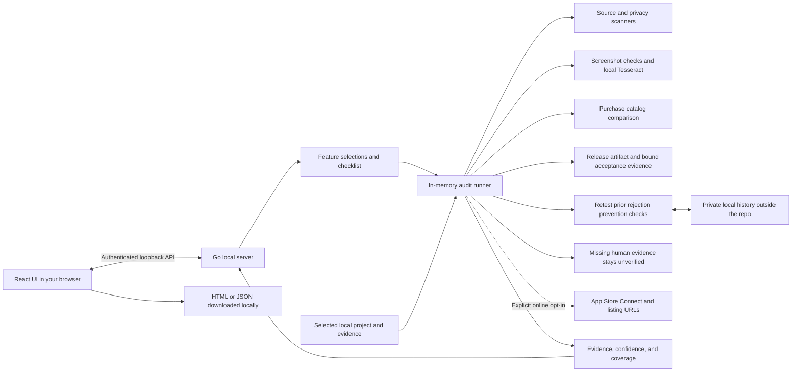
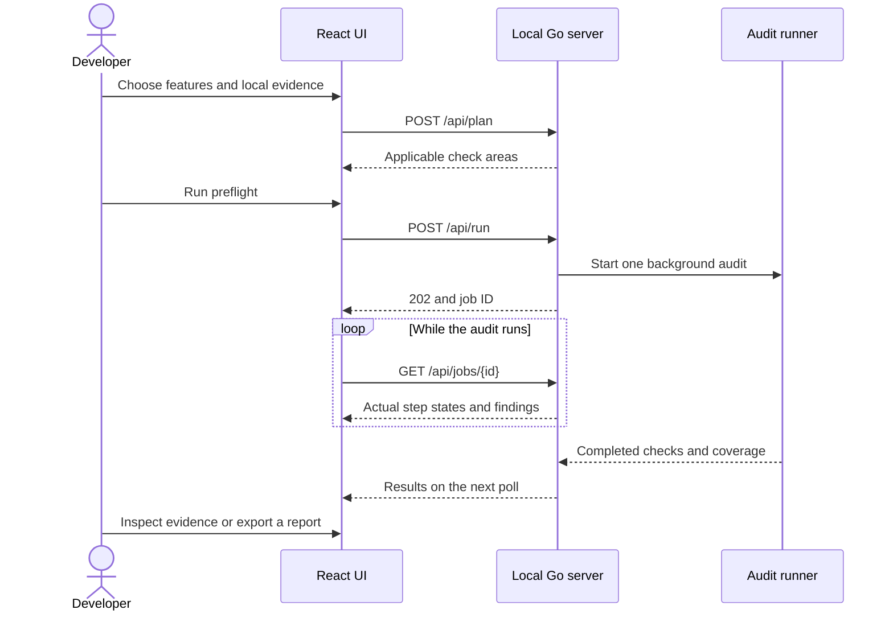

# Greenlight — RandyVentures fork

Free, open-source tools for finding App Store submission problems before you submit.
Local screenshot OCR, purchase catalog comparison, and checks against the exact
App Store version and attached build you intend to submit. The release checklist
also covers candidate packaging and human acceptance, with private local rejection
history to help catch repeat issues.

Based on [RevylAI/greenlight](https://github.com/RevylAI/greenlight). Original
copyright and MIT license are preserved. This fork is maintained by RandyVentures;
it is not affiliated with Apple and does not predict or guarantee approval.

## Quick start: open the local UI

You need **Git and Go 1.24+**. Node is not required to build or run the committed
version of the UI.

```sh
git clone https://github.com/RandyVentures/greenlight.git
cd greenlight
go build -o build/greenlight ./cmd/greenlight
./build/greenlight ui .
```

Your browser opens to a local URL. Select **Try an example** to run the included
synthetic project, screenshot, and purchase catalogs. It deliberately flags
pricing/trial copy and leaves actual purchase flows unverified.

To audit your own app, stop the server with **Ctrl+C**, then run:

```sh
./build/greenlight ui /absolute/path/to/your/app
```

Choose the platform and features, select local evidence, review the generated
checklist, and select **Run preflight**. Expand findings or export HTML/JSON. The
workspace argument sets the file browser's boundary; use a parent directory if
your project and evidence live in sibling folders.

For a fixed port or to open the URL manually:

```sh
./build/greenlight ui /absolute/path/to/your/app --port 8080 --no-open
```

Use the **full URL printed by the command**, including its session fragment.
Reports remain in memory until exported; stopping the server clears them.
Rejection records saved explicitly through **Rejection history** persist privately
in your OS user configuration directory, outside your app repository by default.

**Guideline freshness:** scans use rules bundled with your installed version.
Greenlight does **not** fetch or apply the latest Apple guidelines automatically.
See [how rules and updates work](#apple-guidelines-and-rule-updates).

## Install the CLI on your PATH

With Go 1.24 or newer:

```sh
go install github.com/RandyVentures/greenlight/cmd/greenlight@main
```

Ensure your Go binary directory (`go env GOBIN`, or `$(go env GOPATH)/bin` when
GOBIN is unset) is on your PATH. Then you can run `greenlight ui /path/to/app`
from any directory. The quick-start commands use the built binary directly and
do not require a PATH change.

Or build this fork:

```sh
git clone https://github.com/RandyVentures/greenlight.git
cd greenlight
make build
./build/greenlight --help
```

Screenshot recognition uses [Tesseract](https://github.com/tesseract-ocr/tesseract)
installed locally. Use `brew install tesseract` on macOS or
`sudo apt-get install tesseract-ocr` on Ubuntu. Install additional language packs
for screenshots in other languages. Other commands do not require OCR.

The upstream Homebrew formula installs upstream Greenlight, **not this fork**.
There are no fork-specific binary releases yet; build from source or use Go.

## Local React workspace

```sh
greenlight ui /path/to/your/app
```

Opens a small local interface for selecting iOS/macOS, StoreKit or RevenueCat,
accounts, tracking, screenshots, and localization. Browse local evidence, review
the tailored checklist, run the existing scanners, inspect screenshot highlights,
and export a self-contained HTML or JSON report.

The production React assets are embedded in the Go binary: **no Node server,
Electron, external fonts, or runtime package downloads**. JavaScript and CSS are
about **83 KB combined over gzip**. The server listens only on `127.0.0.1`, keeps
reports in memory, and defaults to offline checks. App Store Connect requests
require explicitly enabling the optional online check and existing API credentials.

From this repository, run `make ui` and select **Try an example** to inspect the
included synthetic fixtures. `greenlight ui . --no-open` prints the URL without
opening a browser. Stop with Ctrl+C.

[UI documentation, scope, and development](docs/local-ui.md)

## How it works

One Go process serves the bundled React interface and runs the existing scanners.
There is no separate frontend server, database, or hosted processing service.





Core source checks always run. Feature selections add checks; they do not suppress
code patterns that could reveal an undeclared feature. Excluded areas are recorded
as not selected. Missing evidence and human checks without valid attestations remain
unverified.

[Architecture, module map, and data boundaries](docs/architecture.md)

## Apple guidelines and rule updates

**No automatic guideline synchronization is implemented.** These are separate
pieces of the tool:

| Component | Where its information comes from | Updated during a scan? |
| --- | --- | --- |
| `guidelines list/search/show` | Curated summaries embedded from `internal/guidelines/data/guidelines.json` | No; bundled with the binary. |
| Scanner rules | Go implementations for patterns, manifests, metadata, binaries, screenshots, and catalogs | No; changes require reviewed code and a rebuilt binary. |
| Screenshot dimensions | A supported subset in `internal/screenshots/dimensions.go`, checked on 2026-10-28 | No; unknown display types stay unverified. |
| ASC app/version/build information | Read-only Apple API requests when `scan` or the UI's online check is explicitly run | Yes, app data is fetched; policy rules are not updated. |
| Purchase catalogs | The local snapshots you supply | No; refresh snapshots yourself before an audit. |

The guideline summaries are not a complete, authoritative copy of Apple's current
policy. The inherited database has no embedded last-reviewed timestamp. The dated
screenshot-size review does not establish freshness for every scanner rule.
Findings link to official policy where available so you can inspect the source.

Always consult the [current Apple App Review Guidelines](https://developer.apple.com/app-store/review/guidelines/)
and [screenshot specifications](https://developer.apple.com/help/app-store-connect/reference/app-information/screenshot-specifications/)
for policy-sensitive decisions. Fetching new policy text alone would not update
the executable checks: maintainers must interpret the change, amend rules, and add
regression fixtures. There is no `guidelines update` command or scheduled policy
monitor in this repository.

To get the latest code **published in this fork**, update and rebuild:

```sh
# Inside an existing clean clone; stop the running UI first.
git pull --ff-only origin main
go build -o build/greenlight ./cmd/greenlight
./build/greenlight ui /absolute/path/to/your/app
```

For a Go-installed binary, rerun
`go install github.com/RandyVentures/greenlight/cmd/greenlight@main` and restart
the UI. Updating the tool is not proof that every rule matches Apple's latest
policy. [Policy maintenance and freshness details](docs/guideline-maintenance.md)

## What's added

### Release readiness and rejection prevention

The prior reusable checklist is now part of the UI and CLI: candidate identity,
extension versions, release packaging, macOS signature/profile inspection, local
metadata, and 15 conditional human acceptance gates. Features include purchase
and subscription lifecycle, accounts, moderation, content rights, production sync,
and safety. Add custom gates for app-specific regression checks.

```sh
greenlight readiness --artifact /path/to/Release.xcarchive \
  --metadata /path/to/release.json --purchases --subscriptions --format json
greenlight history --project /path/to/app list
```

Human evidence must match the current artifact/input/selection/ruleset binding,
include a reviewer and evidence-file hash, and be no more than seven days old.
These are recorded attestations; Greenlight does not independently perform the
human tests or turn a static failure into a pass.

Use **Rejection history** to record actual Apple rejections or internal findings,
root causes, fixes, and prevention steps. Linked rules are rechecked on every
selected audit, including for resolved records. Missing/skipped checks stay
unverified. Saved history is private local data by default; exports may include
issue summaries and prevention steps.

[Checklist crosswalk](docs/checklist-crosswalk.md) ·
[Readiness inputs and evidence](docs/release-readiness.md) ·
[Rejection history and storage](docs/rejection-history.md)

### Screenshot auditing

```sh
greenlight screenshots ./screenshots/en-US --display-type APP_IPHONE_67 --format html --output screenshot-report.html
greenlight screenshots ./screenshots/es-MX --display-type APP_IPHONE_67 --ocr-language spa --format json --exit-code
```

Recursively reads PNG/JPEG files, checks dimensions and PNG alpha declarations,
and uses local OCR to flag pricing/free-trial copy, placeholders, and references
to other mobile platforms. HTML reports embed images and highlight matching text.
No screenshot upload, AI account, or API key is needed.

Use one device display type per invocation; keep different sizes in separate
folders. Without `--display-type`, dimensions are explicitly **unverified**.
Unknown display types, unreadable files, missing OCR, and low-confidence negative
text checks never count as clean results. Text flags require human review,
including legitimate in-app content that happens to match a phrase.

[Screenshot documentation and limitations](docs/screenshots.md)

### Purchase configuration consistency

```sh
greenlight purchases examples/purchases/config.json --format json
greenlight purchases ./purchase-audit.json --exit-code
```

Compares expected product IDs against quoted literals in source, Xcode `.storekit`
files, supplied ASC product snapshots, and a documented normalized RevenueCat
product/entitlement snapshot. Extra legacy products are allowed.

This command runs offline. It does **not** fetch live catalogs, execute purchases,
verify restore/refund behavior, or prove IAPs are attached to a submission.
Those behaviors remain **unverified**, even when every catalog matches.

[Purchase snapshot format and example](docs/purchases.md)

### Exact App Store submission checks

```sh
greenlight auth setup
greenlight scan --app-id YOUR_APP_ID --platform IOS --version-id YOUR_VERSION_RESOURCE_ID --build 8 --format json --exit-code
```

Uses read-only ASC API requests. All version-dependent checks use the selected
version. Build processing and encryption checks follow **that version's attached
build**, never the newest upload. `--build` asserts an expected attached build
number; it does not change Apple's selection.

Without `--version-id`, the scanner selects a version only if exactly one editable
version matches. Ambiguous versions require explicit selection. Versions,
localizations, screenshot sets, and screenshots are paginated. Screenshot checks
inspect every returned localization and verify asset delivery state.

API failures mark coverage incomplete in terminal, JSON, and JUnit reports;
`--exit-code` fails on blockers or incomplete coverage. Required device coverage,
locale fallback, privacy declarations, and functional QA still require review.

`scan` implements tiers 1–2 (metadata and text rules); binary inspection is a
separate `preflight --ipa` operation. Unknown display types are unverified rather
than rejected by an outdated size table.

## Reading results

The new local auditors report each check as:

| Status | Meaning |
| --- | --- |
| `passed` | Supplied evidence satisfied this particular check. |
| `failed` | A concrete mismatch or invalid input was found. |
| `suspected` | A heuristic matched; inspect the evidence before changing anything. |
| `unverified` | Evidence is missing, unreadable, unsupported, or outside scope. |

Reports include confidence, evidence, policy links where applicable, and coverage
counts. Coverage measures checks evaluated; it is **not** a rejection probability.
`--exit-code` on local auditors fails for failed/suspected findings or missing
**required** evidence. Optional out-of-scope runtime checks do not fail a catalog
comparison. Without `--exit-code`, findings are reported without failing the command.

Report files must be new paths; auditors refuse to overwrite existing files.
Keep private screenshots and account snapshots out of public Git history.

## Existing scanners

The fork retains upstream's source, privacy, binary, and Android scanners:

```sh
greenlight preflight . --ipa build.ipa --format json --exit-code
greenlight codescan .
greenlight privacy .
greenlight ipa build.ipa
greenlight playscan . --apk app-release.apk --exit-code
greenlight guidelines search privacy
```

Static rules are heuristics, including inherited rules. A source match cannot
prove a flow works. Platform/payment rules can depend on region and app category;
review current official policy before applying a suggested fix.

The inherited `verify` command integrates with the external Revyl cloud service
and requires its CLI/account. It is optional and **not required** for this fork's
additions. We have not validated that external service in this fork.

## CI and contributing

```yaml
- uses: actions/checkout@v4
- uses: actions/setup-go@v5
  with:
    go-version-file: go.mod
- run: go build -o build/greenlight ./cmd/greenlight
- run: ./build/greenlight purchases examples/purchases/config.json --exit-code
```

Run `go test -race ./...`, `go vet ./...`, and `gofmt -l .` before contributing.
Tests use synthetic fixtures and mocked read-only Apple API responses. They do
not establish agreement with Apple's real review decisions. See
[CONTRIBUTING.md](CONTRIBUTING.md) for rules and false-positive reports.

## License and attribution

[MIT](LICENSE). Greenlight was created by Revyl and its contributors.
RandyVentures maintains this fork's additions. No paid tier, subscription,
or hosted service is required for the screenshot, purchase, or ASC audit tools.
