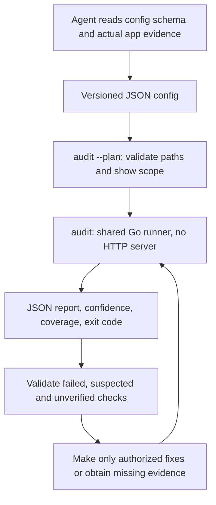

# Headless CLI for agents and CI

The UI is optional. `greenlight audit` runs the complete configured workflow
synchronously inside the Go process: source/privacy, screenshots, purchases,
locales, optional ASC, release acceptance, and private rejection-history retests.
It does not start an HTTP listener, open a browser, or require Node/Electron.
The CLI and UI call the same input validation and runner; there is no separate
agent implementation of the rules.

## Start an audit

```sh
# Run inside your app's project directory:
greenlight audit init
# Edit greenlight.audit.json to describe the actual platform/features/evidence.
greenlight audit --config greenlight.audit.json --plan
greenlight audit --config greenlight.audit.json --output report.json
```

`init` writes a starter config and refuses to overwrite an existing file. It does
not auto-detect or certify your app's features. Configure what the app actually
uses and supply existing evidence. No audit creates credentials, changes app code,
adds rejection records, performs purchases, submits, or deploys anything.

Run the repository's synthetic example:

```sh
greenlight audit --config examples/audit/config.json --plan
greenlight audit --config examples/audit/config.json --exit-code=false
```

It deliberately finds pricing copy and leaves real acceptance unverified. OCR
requires locally installed Tesseract; other selected steps still report their
results if OCR evidence is unavailable.

## Configuration version 1

A minimal source/readiness configuration:

```json
{
  "schema_version": 1,
  "workspace": ".",
  "selection": {
    "project": ".",
    "platform": "ios",
    "payments": "none",
    "readiness": true,
    "history": true
  }
}
```

- `workspace` is relative to the **config file's directory**, independent of the
  agent's working directory. Defaults to `.`.
- All selection file/directory paths are relative to that workspace. Absolute
  inputs are accepted only inside it, including after symlink resolution. Open
  a common parent workspace when project, artifact and evidence are siblings.
- `project` defaults to `.`, `payments` to `none`, and OCR `language` to `eng`.
  `platform` must be `ios` or `macos`. Omitted feature booleans are false.
  The starter explicitly enables readiness and history; don't disable a gate
  merely to get exit 0.
- `readiness` enables candidate/metadata checks and applicable human gates.
  Set `artifact`, `release_metadata`, and `release_evidence` when available.
  Source-only audits remain useful; no artifact cannot establish release acceptance.
- `payments` accepts `none`, `storekit`, or `revenuecat`. Provide `products`,
  `source_files`, and supplied catalogs using the [purchase formats](purchases.md).
  Mixed RevenueCat catalogs may leave a consumable's entitlement blank; at least
  one expected entitlement is required in RevenueCat mode.
- `screenshots` enables the selected `screenshot_path`, `display_type`, and
  `language`. Use one intended display type per run. `localized` and `locales`
  add folder coverage; they do not establish translation quality.
- `accounts`, `tracking`, `subscriptions`, `public_content`, `third_party_content`,
  `cloud_sync`, and `safety_sensitive` set the applicable scope/gates.
- `history` reads the selected project's private local records. `--state-dir`
  selects a private storage override on the command line; a repository config
  cannot redirect that directory. Run `greenlight history ...` separately to
  explicitly add or resolve a documented issue.
- `live_asc` needs known `app_id` and `version_id` (optional expected `build`),
  existing credentials, **and** `--allow-online` on that invocation. It is never
  silently enabled by a checked-in config. A plan can list online work without
  that flag because planning makes no service requests.

Unknown fields, unsupported config versions, invalid feature combinations,
extra JSON documents, and invalid selected paths are rejected. Config files are
limited to 1 MiB. Get the machine-readable shape without scanning anything:

```sh
greenlight audit schema > audit-config.schema.json
```

The schema reflects the shared selection type; the Go validator also enforces
conditional requirements and workspace boundaries. The config file itself may
be outside the workspace. Configs contain paths and identifiers, not API keys.

## Structured output and exit codes

JSON is the default. Stdout contains one JSON report (or one plan document), with
no progress banner. Diagnostics go to stderr. On pre-run configuration errors,
there is no report and stdout is empty. `--output` writes a **new** report file;
it refuses to overwrite existing files. Use a fresh report filename for each
rerun, or consume stdout. Relative output and `--state-dir` paths
use the shell's current directory. Keep outputs outside candidates/input folders
so writing a report does not change evidence you just hashed.

| Exit | New `audit` command meaning |
| --- | --- |
| `0` | Selected checks passed their gate, or a valid plan was produced. Excluded checks are not certified. |
| `1` | Report produced, with failures, suspected findings, or missing required evidence. |
| `2` | Invalid config/output, rejected online use, or an audit step failed to execute. A partial report is emitted when a run already started. |

`--exit-code=false` disables the findings gate for report-only use; execution and
configuration errors still return 2. Missing evidence represented as a completed
unverified check (for example unavailable OCR) normally returns 1, not 2. Older
scanner commands retain their existing exit behavior.

The report has `schema_version: 1`, `kind: "greenlight-audit"`, `tool_version`,
workspace/selection provenance, `steps`, `rows`, `summary`, `scope`, limitations,
and release evidence bindings when applicable. Rows retain `id`, `group`, status,
confidence/reason, evidence, fix and source paths. A plan has
`kind: "greenlight-audit-plan"` and `plan`; it contains no scan results.
JSON omits screenshot thumbnails by default to keep agent output compact;
`--include-images` opts in. HTML includes available local thumbnails.

```sh
greenlight audit --config greenlight.audit.json --format terminal
greenlight audit --config greenlight.audit.json --format html --output report.html
greenlight audit --config greenlight.audit.json --allow-online --output online-report.json
```

On macOS, strict signature verification needs normal OS trust/keychain access.
A recognized sandbox/trust-access failure is required **unverified**, not a
confirmed corrupt signature. Rerun with appropriate local access before changing
signing. A genuine invalid sealed resource remains a failure.

These commands are independent audits. A report's statuses, confidence and scope
matter more than its process code. Human evidence is an attestation, not an
independently performed test; the agent must not invent acceptance notes, Apple
rejections, catalog snapshots or approval probabilities. See [confidence and
validation](confidence-and-validation.md) and [release evidence](release-readiness.md).

## Agent loop



A suitable agent instruction is:

> Run Greenlight's headless audit using the existing config and evidence. Read
> the JSON report even on nonzero exit. Validate each suspected finding against
> the actual target, source/artifact and current policy. Distinguish missing
> evidence from a broken feature. Make only authorized changes, rerun affected
> checks, and report remaining limitations. Do not weaken scope or fabricate
> human/runtime evidence to obtain a passing result.

## CI example

```yaml
- uses: actions/checkout@v4
- uses: actions/setup-go@v5
  with:
    go-version-file: go.mod
- run: go build -o build/greenlight ./cmd/greenlight
- run: ./build/greenlight audit --config greenlight.audit.json --output report.json
- uses: actions/upload-artifact@v4
  if: always()
  with:
    name: greenlight-report
    path: report.json
```

Install Tesseract/language packs in the job when screenshots are selected. Fresh
runners have no private rejection history unless you deliberately provision it;
no records is not evidence of no prior rejections. Do not put actual private
history or credentials into a public repository. Report artifacts can include
private source paths and review summaries; control their visibility.
