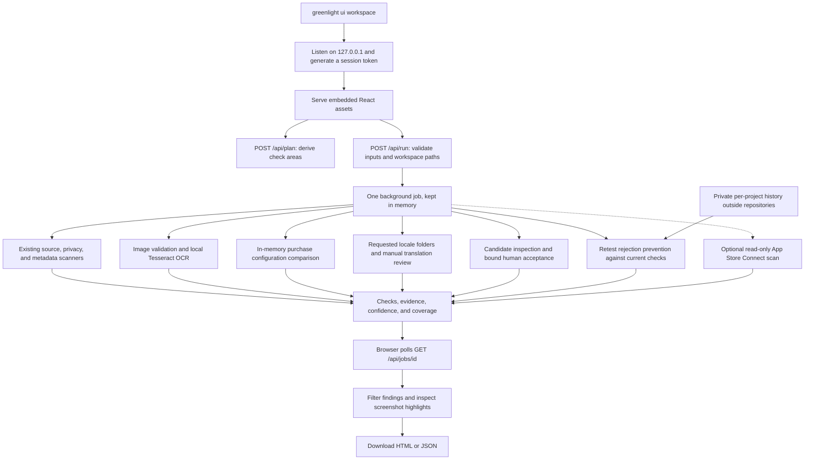
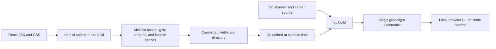

# Architecture

Greenlight is a Go CLI with a React workspace embedded into the same binary.
The UI calls Go packages directly through a loopback API; it does not launch
scanner commands through a shell or upload projects to a hosted backend.

## Runtime and data flow

The local UI exposes source/privacy, screenshots, purchases, localization, release
acceptance, local rejection history, and optional ASC flows. Candidate files stay
on disk; readiness reads selected `.app`, `.xcarchive`, or `.ipa` paths locally.
Inherited IPA and Android commands remain available separately; the UI does not
add a Google Play workflow.

## What feature selections change

| Selection | Added work | Evidence and limits |
| --- | --- | --- |
| Project folder | Core source/privacy checks always run | Static patterns are heuristic; declarations do not prove runtime behavior. |
| Screenshot audit | Image checks and local OCR | One intended display type per run; OCR misses and unsupported types remain visible. |
| StoreKit | Product/catalog comparison | Exact source literals, optional `.storekit`, and supplied ASC product snapshot. |
| RevenueCat | StoreKit-style product comparison plus entitlement mapping | Requires expected entitlements and the documented normalized RevenueCat snapshot. |
| Multiple languages | Locale-folder coverage and translation-review reminder | Folder presence does not validate copy or store fallback. |
| Accounts | Sign-in/deletion acceptance gate | Requires bound human evidence; no account is created or deleted. |
| Tracking | Consent/disclosure scope | Human privacy acceptance covers shipped behavior; no SDK traffic or consent timing is exercised. |
| Release acceptance | Artifact/metadata inspection and applicable human gates | Missing/stale evidence stays unverified; see [evidence binding](release-readiness.md). |
| Past rejections | Match every saved record to current checks | Resolved records still run; state lives in private local files by default. |
| Online ASC | Read the specified version and attached build | Saved API-key credentials stay in Go; metadata URL checks can also make requests. |

Disabling a feature excludes its additional checks; it does not create a passed
result. Core source patterns still run and may flag conflicting declarations.
The exported report records exclusions in its scope notes.

## Browser and local API boundary

The server listens only on IPv4 loopback. It validates the Host header, API session
token, request origin, and browser fetch-site header where present. Selected paths
are resolved, including symlinks, before checking the workspace boundary. There
is no general-purpose file-download or shell-execution API.

| Route | Purpose |
| --- | --- |
| `GET /` and static assets | Embedded production React/CSS, with precompressed JS/CSS variants. |
| `GET /api/info` | Workspace name/path and example availability. |
| `GET /api/browse?path=...` | List visible entries inside the opened workspace. |
| `POST /api/plan` | Compute the check areas from current selections. |
| `GET /api/history` and `POST /api/history` | Read or explicitly add/resolve private project rejection records. |
| `POST /api/run` | Validate inputs and return an accepted job ID. |
| `GET /api/jobs/{id}` | Read progress and results. |
| `GET /api/jobs/{id}/html` | Render the same report as escaped, self-contained HTML. |

API routes require the local session token. The launch URL carries it in a fragment
that the browser removes after loading. A tab-scoped session-storage entry supports
reloads; app selections and reports are not stored there. One audit runs at a time,
and the last eight reports remain in process memory until the server exits.

The job runner uses a five-minute context deadline; screenshot OCR has a per-image
timeout. This is not a hard stop for every inherited scanner: source scanning does
not currently take a context, and some Apple requests may finish after cancellation.
Stopping the CLI ends the local process. These limits should not be interpreted as
a guaranteed maximum audit duration.

Screenshots stay local. Up to 12 thumbnails are included in UI results. Reports can
contain code paths, recognized text, and thumbnails; exports are ordinary local
downloads the developer controls. Default UI audits require no outbound requests.
Saved rejection history persists independently of in-memory reports, using atomic
private JSON files under OS user configuration. Only the CLI selects a storage
override; the browser cannot change that root. History API project paths follow
the same workspace/session boundary. History findings in exports include issue
summaries and prevention steps.

Enabling ASC can contact Apple and URLs from the app's listing. The inherited
Revyl cloud integration is a separate CLI workflow, never an implicit UI step.

## Source map

| Location | Responsibility |
| --- | --- |
| `cmd/greenlight/` | Binary entrypoint and version. |
| `internal/cli/ui.go` | `ui` command, signals, and browser launch. |
| `internal/localui/server.go` | Embedded assets, session checks, file browser, loopback server. |
| `internal/localui/plan.go` | Feature-selection schema, validation, and checklist derivation. |
| `internal/localui/runner.go` | Background jobs, scanner adapters, thumbnails, coverage, and exclusions. |
| `internal/cli/readiness.go` | Readiness and private history CLI commands. |
| `internal/readiness/` | Candidate/metadata inspection, conditional human gates, SHA-256 evidence binding. |
| `internal/history/` | Private atomic project history and current-check regression matching. |
| `internal/localui/readiness.go` | UI readiness adapter and authenticated history API. |
| `internal/localui/html.go` | Self-contained HTML export. |
| `internal/localui/web/src/` | React UI, styles, and frontend model tests. |
| `internal/localui/web/static/` | Committed production assets embedded by Go. |
| `internal/audit/` | Shared local-auditor status, evidence, and coverage model. |
| `internal/preflight/`, `codescan/`, `privacy/` | Static scanners and aggregation; UI honors explicit Apple platform. |
| `internal/sourcepath/`, `buildsettings/` | Generated/test exclusions and matching XcodeGen Info.plist injection. |
| `internal/screenshots/`, `purchases/` | Local evidence auditors used by both UI and CLI. |
| `internal/asc/`, `checks/` | Read-only Apple client and submission checks. |
| `internal/guidelines/` | Bundled guideline-summary lookup; not the scanner's rule engine. |

## Build pipeline

Ordinary Go builds use committed assets, so Node is needed only when changing the
frontend. CI runs frontend tests, rebuilds assets, and checks for drift; Go jobs
check formatting, vet, build, and race-enabled tests. Workflows describe configured
checks, not a guarantee that a particular hosted run has completed successfully.

See [local UI development](local-ui.md), [purchase formats](purchases.md), and
[guideline freshness](guideline-maintenance.md) for implementation limits.

[Prior checklist crosswalk](checklist-crosswalk.md) · [Rejection lifecycle](rejection-history.md)

[Confidence rubric and validation](confidence-and-validation.md) explains evidence strength and source limits.
