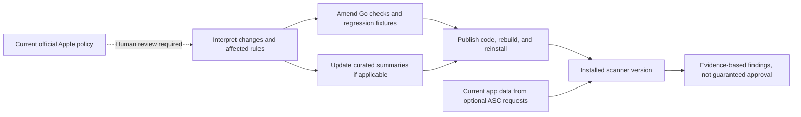

# Guideline provenance and maintenance

## Does Greenlight always pull the latest Apple rules?

**No.** Normal scans do not retrieve Apple's guideline page or dynamically update
their rules. There is no guideline-refresh command, self-updating policy engine,
or scheduled policy monitor in this fork.

There are three distinct sources of information:

1. **Bundled summaries:** `internal/guidelines/data/guidelines.json` is embedded
   into Go. `guidelines list`, `search`, and `show` read those curated summaries.
   They are not a complete or guaranteed-current copy of Apple's policy. The
   inherited dataset does not include an authoritative last-reviewed timestamp.
2. **Executable rules:** source patterns, privacy-manifest checks, metadata rules,
   accepted dimensions, and catalog checks are implemented separately in Go.
   Editing the summary JSON alone does not alter the scanners. The source currently
   loads the summary database only in guideline-browsing CLI commands.
3. **App evidence:** local files and supplied catalog snapshots, or current Apple
   app/version/build data fetched by an explicitly requested ASC scan. Fresh app
   data does not establish that the scanner rules are current.



The dotted step represents a maintainer task, not an implemented automatic fetch.
The existing screenshot-size subset was checked on **2026-10-28**, as recorded in
`internal/screenshots/dimensions.go` and `docs/screenshots.md`. That date does not
apply to every code, payment, privacy, or platform rule. Unknown screenshot display
types are unverified rather than rejected using an assumed size.

## What updates when you run a command?

| Action | Fetches current information? | Changes local policy rules? |
| --- | --- | --- |
| `greenlight guidelines search privacy` | No, searches bundled summaries. | No. |
| `greenlight preflight .` | No policy fetch; reads local evidence. | No. |
| `greenlight screenshots ...` | No, reads images and runs local OCR. | No. |
| `greenlight purchases ...` | No, reads supplied snapshots. | No. |
| `greenlight scan --app-id ...` | Reads Apple app data and checks listing URLs. | No. |
| Opening the local UI | Loads embedded assets and local workspace information. | No. |
| Updating/rebuilding Greenlight | Downloads the code published by this fork. | Includes whatever rule changes maintainers have published. |

The standalone Revyl runtime integration can make cloud requests, but it is not a
guideline-update mechanism and does not run implicitly in the local UI.

## Maintainer update process

When reviewing a policy change:

1. Read the current official rule and relevant platform documentation. Record the
   exact source, affected platforms/regions, and review date in the change.
2. Determine whether the rule can be checked mechanically, only inferred, or must
   remain unverified. A new sentence on Apple's page is not executable logic.
3. Amend the owning Go check. Update summaries separately if relevant; do not
   copy the entire policy page into the repository as an unreviewed replacement.
4. Add synthetic positive, negative, and plausible false-positive fixtures.
   Update scope/limitations when a condition cannot be established from evidence.
5. Run the relevant tests and repository checks, publish the reviewed changes,
   and rebuild the distributed binary. Existing installed binaries do not change.

An optional future freshness checker could fetch official pages on explicit request
and report detected changes. It would still need a reviewed baseline and a rule
maintenance process; it should not silently rewrite checks or claim that downloading
policy text made an app compliant. This is a proposal, not an available command.

## Updating your installation

Go-installed version:

```sh
go install github.com/RandyVentures/greenlight/cmd/greenlight@main
```

Existing clean source clone:

```sh
git pull --ff-only origin main
go build -o build/greenlight ./cmd/greenlight
./build/greenlight version
```

Stop and restart any running UI process to use the new binary and embedded assets.
Supplying fresh purchase snapshots is a separate step. Neither an up-to-date
installation nor a clean report guarantees approval.

## Official references

- [App Review Guidelines](https://developer.apple.com/app-store/review/guidelines/)
- [Screenshot specifications](https://developer.apple.com/help/app-store-connect/reference/app-information/screenshot-specifications/)
- [App Store Connect API](https://developer.apple.com/documentation/appstoreconnectapi)

Consult the relevant current official source when making a policy-sensitive decision.
