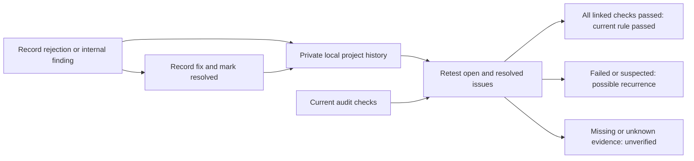

# Rejection history and repeat prevention

Open **Rejection history** in the local UI. Select whether the issue came from an
actual Apple review or an internal preflight finding. Record the guideline,
reviewed version/build/date, what happened, root cause, and concrete prevention
steps. Only summary and prevention are mandatory. Save explicitly; audits do not
invent or automatically import Apple rejections.

Link an existing check from the menu, or enter an exact check ID from a JSON report.
For a bespoke regression, define a [custom acceptance gate](release-readiness.md)
and link `human.custom.your-id`. Leave the check ID blank for a manual reminder.
To resolve an issue, record the fix. Resolution preserves the record and its
prevention check; it does not waive future testing.

## How a later audit uses it

**Recheck past rejections** is enabled by default. After current checks finish,
Greenlight compares each saved record, including resolved ones, with all current
rows matching its exact rule ID:

| Current evidence | History result |
| --- | --- |
| Any matching check failed or is suspected | `suspected`: possible recurrence; inspect current evidence. |
| Every matching check passed | `passed`: that rule passed now; manually confirm it covers the original issue. |
| Any other status, no matching rule, skipped area, or no linked rule | Required `unverified`: perform the prevention work. |

A rule can cover several files or products. A broad rule pass does not establish
that the complete original rejection was fixed. No matching evidence counts as
incomplete, never a clean retest. Existing automated failures remain visible too.



## Storage and privacy

By default records live outside app repositories in the OS user configuration
folder, under `greenlight/rejection-history`:

- macOS: `~/Library/Application Support/greenlight/rejection-history/`
- Linux: `$XDG_CONFIG_HOME/greenlight/rejection-history/`, or
  `~/.config/greenlight/rejection-history/` when unset.
- Windows: the Go runtime's user configuration directory, generally `%AppData%`.

Each project's canonical absolute path selects a SHA-256-named JSON file. Symlink
aliases refer to the same project; moving the project creates a different history
key. There is no account sync, cloud service, or automatic migration between paths.
The default file mode is 0600, directory creation 0700, with atomic writes and a
per-project writer lock. Protect and back up the directory as private app data.
`--state-dir /private/location` on `ui` or `history` chooses an alternative; choosing
a directory inside a Git repository would remove the default separation.

Limits: 1,000 records and 4 MiB per project. Corrupt or unsupported-schema files are
reported rather than overwritten. A crashed writer can leave a `.lock`; only remove
that file after confirming no Greenlight process is writing that project. The log
is developer-maintained, not tamper-proof or authenticated Apple correspondence.

The full history is not bundled into an audit export. However, history result rows
include issue summaries and prevention steps, so exported HTML/JSON may contain
private review details. Review exports before sharing. Public examples and tests
use synthetic data; no real app rejection history ships with this fork.

## CLI

```sh
greenlight history --project /path/to/app add \
  --origin apple_review --guideline 2.3.7 --version 1.0 --build 12 \
  --review-date 2026-10-28 \
  --summary 'Public screenshots contain stale pricing' \
  --cause 'Old promotional screenshot was reused' \
  --prevention 'Run OCR and visually inspect every current public screenshot' \
  --rule pricing-copy

greenlight history --project /path/to/app list
greenlight history --project /path/to/app resolve RECORD_ID \
  --fix 'Replaced screenshots and checked the uploaded set'

# UI JSON export or a readiness report with checks/rows:
greenlight history --project /path/to/app check /path/to/current-report.json --exit-code
```

CLI `history check` evaluates only the report supplied; it does not rerun scanners
or validate the report's age. Supply a fresh report from the candidate under review.
The UI automatically uses its current run. Inherited CLI reports using a `findings`
array instead of `checks`/`rows` are not supported by this command.
